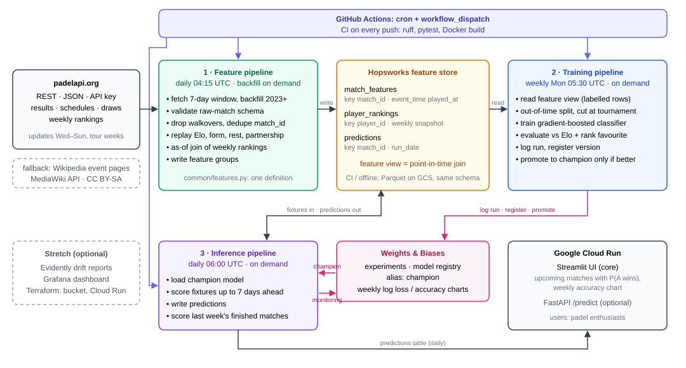

# 🎾 Padel Predictor

**Predicts the winner of a professional padel match before it is played** — the
probability that team A beats team B, for every fixture up to seven days ahead,
refreshed daily.

Built for HSLU **MLOps HS26 (I.BA_MLOPS)** as three automated pipelines: a
feature pipeline that ingests live results, a training pipeline that retrains
and promotes models, and an inference pipeline that serves predictions.

| | |
| --- | --- |
| 🌐 **Live app** | _Deployed at MS4 — link goes here_ |
| 🎬 **Video pitch** | _Recorded at MS4 — link goes here_ |
| 📄 **Docs** | [`docs/`](docs/) — proposal and milestone summaries |

---

## Architecture



| Layer | Production | Offline (tests, fresh clone) |
| --- | --- | --- |
| Feature store | **Hopsworks** feature groups, `PADEL_FEATURE_STORE_URI=hopsworks://<project>` | versioned Parquet snapshots under `data/feature_store` |
| Tracking & registry | **Weights & Biases** runs and `model` artifacts with a `champion` alias, `PADEL_TRACKING=wandb` | the same contract on disk under `data/model_registry` |
| Orchestration | GitHub Actions cron + `workflow_dispatch` | the `padel` CLI |

The offline backends exist so that a reviewer can clone and run everything
without an account; the scheduled workflows use the hosted ones, because a
GitHub Actions runner starts with an empty disk every time.

| Pipeline | Trigger | What it does |
| --- | --- | --- |
| **1. Feature** | daily cron 04:15 UTC, plus backfill on demand | Fetches results, fixtures and ranking snapshots, rebuilds features, upserts them into the Hopsworks feature store |
| **2. Training** | weekly cron, plus on demand | Reads the feature store, trains, evaluates against the provider's Elo, logs the run to Weights & Biases and moves the `champion` alias if better |
| **3. Inference** | daily cron 06:00 UTC, plus on demand from the UI | Loads the champion model, predicts upcoming fixtures, stores the predictions |

### What the model sees

Six team-difference features (team A minus team B), all replayed in
chronological order so a row only ever sees matches that finished earlier.
Padel is played in pairs, so each player-level value is first aggregated to the
pair:

| Feature | Team value |
| --- | --- |
| `elo_diff` | mean of the two players' in-house Elo (start 1500, K = 24) |
| `rank_points_diff` | sum of the two players' official points, from the last ranking snapshot **published before** the match |
| `form_diff` | mean of the two players' win rates over each player's last 5 matches, with any partner (0.5 without history) |
| `rest_days_diff` | days since the pair's most recently active player last played, capped at 60 (14 if never seen) |
| `partnership_diff` | matches this exact pair has played together before |
| `tier_level` | ordinal tier of the event: major and finals 4, p1 3, p2 2, FIP Platinum and Gold 1 |

A new partnership starts at `partnership = 0`, but Elo, form and rest stay per
player, so two strong players who just paired up keep their strength.
Teams are assigned to side A or B by a hash of the two pair names, never by
the source's (seeded) order, so the label is balanced.

The provider's own Elo is **not** a feature: it is the baseline. Its win
probability (`provider_elo_prob`, mean of the two players' provider Elo) is
stored next to each feature row and scored on exactly the same test matches as
the model.

Two design decisions carry most of the weight:

- **One feature definition.** Training and inference both import
  `build_feature_frame` from [`src/padel_predictor/common/features.py`](src/padel_predictor/common/features.py).
  There is no second implementation anywhere, so training and serving cannot drift apart.
- **No leakage by construction.** A match's own result is folded into the rolling
  state only *after* its feature row is built. A unit test asserts it: flipping a
  match's winner must not change that match's features.
- **Rankings join on publication time.** Ranking snapshots are weekly and a
  tournament runs Wednesday to Sunday, so a snapshot labelled with a tournament
  week can already contain that week's results. Each player gets the latest
  snapshot whose `published_at` is strictly before the scheduled start; backfilled
  snapshots without a publication time count as published seven days after
  their label date. Unit tests cover the published-after-the-week and
  published-exactly-at-the-start cases.

---

## Clone and run

Requires **Python 3.11+** and [uv](https://docs.astral.sh/uv/). No API key is
needed: the default `sample` source generates deterministic synthetic matches
offline, so a fresh clone runs the whole system end to end.

```bash
git clone https://github.com/Noah-Rod/padel-predictor.git
cd padel-predictor
cp .env.example .env          # edit only if you use a live source
uv sync --all-extras          # Windows without a C compiler: plain `uv sync` (see below)

# 1. Feature pipeline: load history, then keep it current
uv run padel backfill --start 2025-09-01 --end 2026-09-01
uv run padel feature-pipeline
uv run padel data-report      # counts per season/tier + baselines on the test split

# 2. Training pipeline: train, evaluate, promote to @champion
uv run padel training-pipeline

# 3. Inference pipeline: predict the upcoming fixtures
uv run padel inference-pipeline

# Serve it
uv run streamlit run ui/app.py        # UI  on http://localhost:8501
uv run padel serve                    # API on http://localhost:8000/docs
```

A single prediction from the command line:

```bash
uv run padel matchup --team-a "Player 01,Player 02" --team-b "Player 03,Player 04"
```

`make help` lists the same steps as short targets.

**Windows.** The Hopsworks client depends on `twofish`, which only ships as
source code and needs Microsoft C++ Build Tools to compile. It is therefore an
optional extra: plain `uv sync` installs everything else, and the offline
store, the tests and the live padelapi.org source all run without it. Only
`PADEL_FEATURE_STORE_URI=hopsworks://...` needs `uv sync --extra hopsworks`;
the scheduled workflows and the Docker image install it.

### With Docker

```bash
cp .env.example .env
docker compose up --build            # api + ui
docker compose run --rm pipelines padel backfill --start 2025-09-01 --end 2026-09-01
docker compose run --rm pipelines padel training-pipeline
```

| Service | URL |
| --- | --- |
| Streamlit UI | http://localhost:8501 |
| API docs | http://localhost:8000/docs |

---

## Configuration

Two separate sources, so no secret is ever committed:

| Where | What | Committed |
| --- | --- | --- |
| [`config/settings.yaml`](config/settings.yaml) | Pipeline behaviour: feature parameters, model hyper-parameters, promotion rules | yes |
| `.env` (see [`.env.example`](.env.example)) | Secrets and environment URIs: API keys, feature store, tracking server | **no** |

In GitHub Actions the same names come from repository **variables** (non-secret,
e.g. `PADEL_FEATURE_STORE_URI`) and **secrets** (`PADEL_API_KEY`,
`HOPSWORKS_API_KEY`, `WANDB_API_KEY`, `GCP_SA_KEY`). On Cloud Run the two API
keys come from Secret Manager (`hopsworks-api-key`, `wandb-api-key`).

### Going live

The scheduled workflows run on ephemeral runners, so anything written to local
disk is discarded when the job ends. For the pipelines to actually accumulate
state, set the secrets `HOPSWORKS_API_KEY`, `WANDB_API_KEY` and `PADEL_API_KEY`,
and these repository variables:

| Variable | Example |
| --- | --- |
| `PADEL_FEATURE_STORE_URI` | `hopsworks://padel_predictor` (your Hopsworks project) |
| `PADEL_TRACKING` | `wandb` |
| `WANDB_PROJECT` / `WANDB_ENTITY` | `padel-predictor` / your W&B user or team |
| `PADEL_SOURCE` | `http` |
| `PADEL_API_BASE_URL` | `https://padelapi.org/api` |
| `PADEL_API_PLAN` | `paid` (Plus or higher: full archive + ranking history) or `free` |

**What the live source reads.** padelapi.org, tournament by tournament as the
provider recommends: `/tournaments` lists the editions running in the window at
the levels in `ingestion.levels` (Premier Padel and FIP Platinum and Gold), then
`/tournaments/{id}/matches` pages through each main draw. `finished` and
`retired` matches are labelled; walkovers, byes and `not_played` are dropped;
a match counts as a fixture once both pairs are drawn. `/rankings` gives one
weekly snapshot per Monday of the official points and the provider's Elo (top
200 per category). Requests are paced under the plan's per-minute limit, a
`429` waits for `Retry-After`, and a used-up daily quota stops the run with a
clear error, so a backfill is resumed by running it again. A year of history
costs roughly 1,000 requests, about 20 minutes on the paid plan.

**Without a subscription.** `PADEL_API_PLAN=free` runs the same pipeline on the
provider's free tier: the backfill is clamped to the last six months and, as
there is no ranking history, only the current ranking is stored, published at
fetch time. Ranking points and the provider baseline are therefore missing for
history and filled in from then on: the numbers get worse, the pipeline does
not break. With no key at all, the default `sample` source runs everything
offline.

The feature and training workflows emit a warning when these are still local.

---

## Repository layout

```
padel-predictor/
├── src/padel_predictor/
│   ├── common/        config, feature store (Hopsworks / Parquet), schemas, features
│   ├── features/      1. ingestion adapters, feature pipeline, backfill
│   ├── training/      2. dataset split, W&B registry, training pipeline
│   ├── inference/     3. predictor, batch pipeline, FastAPI app
│   └── cli.py         one command per pipeline
├── ui/                Streamlit front end
├── config/            settings.yaml (no secrets)
├── tests/             unit tests, run in CI on 3.11 and 3.12
├── notebooks/         exploration only — pipelines never import from here
├── docs/              proposal, milestone summaries, architecture diagram
├── .github/workflows/ ci · feature · training · inference · deploy
├── Dockerfile · docker-compose.yml
└── pyproject.toml · uv.lock · requirements.txt
```

## Development

```bash
uv run pytest                  # unit tests
uv run ruff check .            # lint
uv run ruff format .           # format
```

CI runs lint, format check and the test suite on Python 3.11 and 3.12, and
builds the Docker image, on every push and pull request.

## Milestones

Tagged in git as they are reached:

| Tag | Milestone | Due |
| --- | --- | --- |
| `ms1` | Project proposal | 01.10.2026 |
| `ms2` | Feature pipeline | 05.11.2026 |
| `ms3` | Training pipeline | 03.12.2026 |
| `ms4` | Live system + video | 10.01.2027 |

```bash
git tag ms2 && git push --tags
```

## Licence

MIT — see [`LICENSE`](LICENSE).
